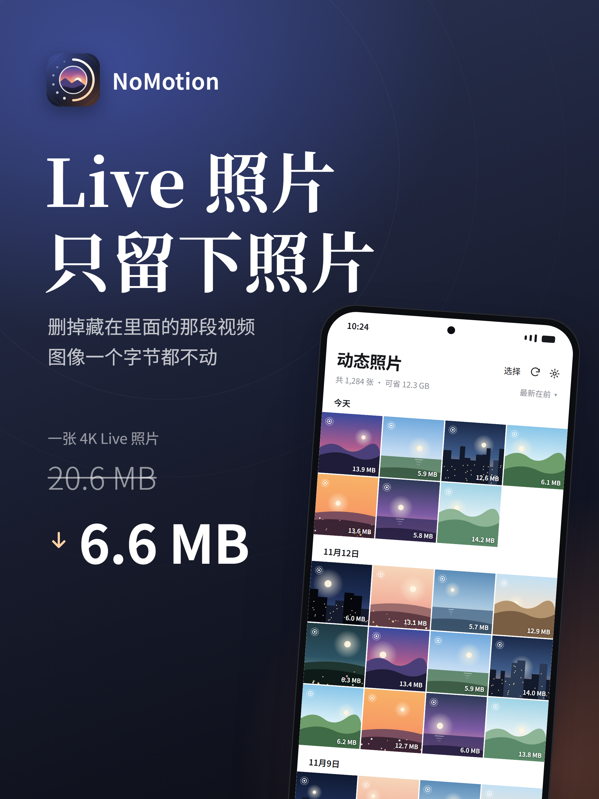
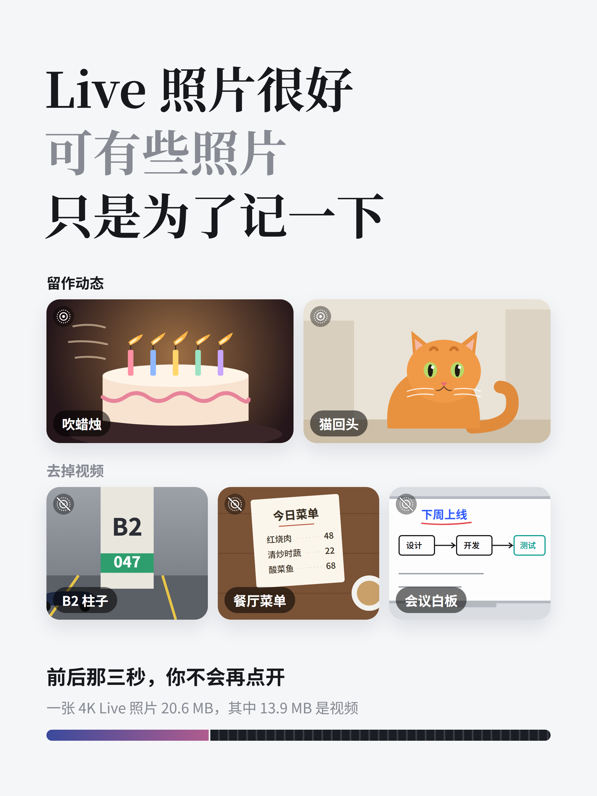
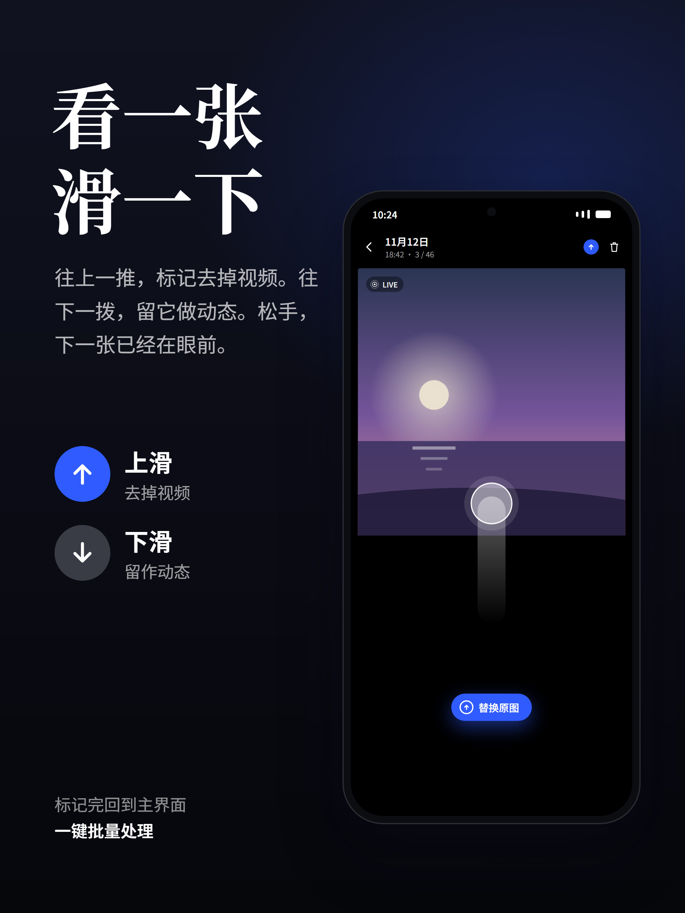

# NoMotion

Live 图我很喜欢，平时拍照都是默认打开 Live 图开关。孩子吹蜡烛那一下，猫回头那一下，三秒视频比一张照片多出好多东西。

可更多时候拍照只是为了记一下：车停在 B2 哪根柱子，餐厅的菜单，会议的白板……这些照片前后那三秒并无意义，却要多占几 MB 甚至十几 MB 的空间。

所以做了个安卓 App 叫 NoMotion，专门用来去掉 Live 图里的视频。图像一个字节都不动。

这个仓库只用来发布安装包，到 [Releases](https://github.com/zhangqihenry/NoMotion-app/releases/latest) 下载最新版。

<p>
  
  
  
</p>

## 能处理的照片

目前主要支持 vivo 手机，其他品牌支持有限。用别的手机又想用的朋友，可以在 [Issues](https://github.com/zhangqihenry/NoMotion-app/issues) 里留言，发几张自己手机拍的 Live 图原文件给我研究。

已经认得的有：

- vivo 的 Live 照片
- 谷歌 Motion Photo 格式的动态照片
- Insta360 应用导出的 Live 照片
- 微信里存下的动态照片

只处理 JPEG 格式。HEIC 格式的动态照片不扫描也不处理。

## 处理时动了什么

- 只删掉视频，还有 XMP 里描述视频的那几个字段。
- 图像不解码，不重新压缩。EXIF、色彩配置、Ultra HDR 增益图原样保留。
- 每张写完都逐字节核对，有一处对不上就跳过这张，原图不动。认不准结构的照片列在"无法处理"里，写明原因。
- 应用没有网络权限，照片不离开手机。

## 怎么用

- 点开一张预览，上滑标记去掉视频，下滑留作动态，松手翻到下一张。回到主界面点"开始批量处理"。上滑、下滑各做什么可以在设置里改。
- 也可以多选后点"去除动态"，或者在相册里把照片分享给 NoMotion。
- 按住照片播放视频，松手停止。
- 处理方式有三种：直接替换原图、另存新图、另存新图并删除原图。

## 安装

要求 Android 11 及以上。下载 `NoMotion-1.0.apk`，在手机上点开安装，系统会请你允许"安装未知应用"。

第一次打开要给两项权限：读取照片，读取照片的位置信息。第二项必须给。没有它，系统交给应用的文件里 GPS 信息被抹掉了，应用读到的不是原文件，就不工作。

"所有文件访问"权限只在"移出相册再移回"时用，不用这个功能可以不给。

## 已知限制

- vivo 相册把"这是 Live 照片"记在它自己的数据库里。直接替换原图后，相册里的 Live 标志还在，视频其实已经删掉了。想让标志消失，处理时选"另存新图并删除原图"，或者用设置里的"移出相册再移回"。
- 另存出来的新图在相册"按添加时间排序"时排在最前面。按拍摄时间排序不受影响。
- vivo 照片里带的 C2PA 内容凭证原样保留。删掉视频后，它的签名校验不再通过。
- 目前只用 vivo 手机和 Insta360、微信的照片测过。其他品牌带私有数据的动态照片会列在"无法处理"里，不会强行处理。

## 校验安装包

安装包用固定的密钥签名，以后的版本都用同一把，可以直接覆盖安装。签名证书的 SHA-256：

```
d84e46196bafe8c7ab9addcf35a1f8646a875ec9d7e565cf64a212b2859c84a6
```

每个安装包自己的 SHA-256 写在对应的发布说明里。
